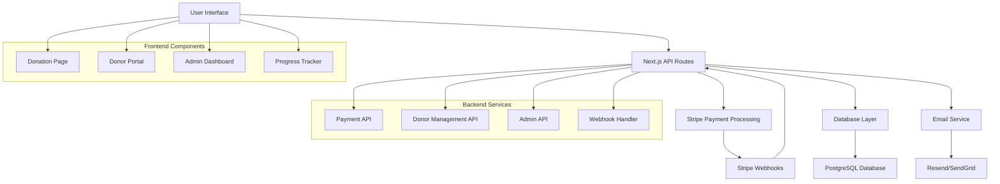

# Donation System Design Document

## Overview

The donation system will be built as a comprehensive solution integrated into the existing Next.js application. It will leverage Stripe for payment processing, implement a custom database schema for donation tracking, and provide both user-facing donation flows and administrative management capabilities.

The system architecture follows a modern full-stack approach with API routes handling business logic, a PostgreSQL database for data persistence, and React components for the user interface. The design prioritizes security, user experience, and scalability while maintaining the existing design language of the DI MI PA BÔS website.

## Architecture

### High-Level Architecture



### Database Schema

```sql
-- Donors table
CREATE TABLE donors (
    id UUID PRIMARY KEY DEFAULT gen_random_uuid(),
    email VARCHAR(255) UNIQUE NOT NULL,
    first_name VARCHAR(100) NOT NULL,
    last_name VARCHAR(100) NOT NULL,
    phone VARCHAR(20),
    address_line1 VARCHAR(255),
    address_line2 VARCHAR(255),
    city VARCHAR(100),
    state VARCHAR(100),
    postal_code VARCHAR(20),
    country VARCHAR(2) NOT NULL,
    stripe_customer_id VARCHAR(255) UNIQUE,
    email_opt_in BOOLEAN DEFAULT false,
    created_at TIMESTAMP DEFAULT NOW(),
    updated_at TIMESTAMP DEFAULT NOW()
);

-- Donations table
CREATE TABLE donations (
    id UUID PRIMARY KEY DEFAULT gen_random_uuid(),
    donor_id UUID REFERENCES donors(id),
    stripe_payment_intent_id VARCHAR(255) UNIQUE,
    amount INTEGER NOT NULL, -- Amount in cents
    currency VARCHAR(3) NOT NULL DEFAULT 'EUR',
    status VARCHAR(20) NOT NULL, -- pending, succeeded, failed, canceled
    payment_method VARCHAR(50), -- card, sepa, bank_transfer
    is_recurring BOOLEAN DEFAULT false,
    stripe_subscription_id VARCHAR(255),
    metadata JSONB,
    created_at TIMESTAMP DEFAULT NOW(),
    updated_at TIMESTAMP DEFAULT NOW()
);

-- Project progress table
CREATE TABLE project_progress (
    id UUID PRIMARY KEY DEFAULT gen_random_uuid(),
    title VARCHAR(255) NOT NULL,
    description TEXT,
    target_amount INTEGER NOT NULL, -- Amount in cents
    current_amount INTEGER DEFAULT 0, -- Amount in cents
    percentage_complete INTEGER DEFAULT 0,
    is_active BOOLEAN DEFAULT true,
    created_at TIMESTAMP DEFAULT NOW(),
    updated_at TIMESTAMP DEFAULT NOW()
);

-- Donation campaigns table
CREATE TABLE campaigns (
    id UUID PRIMARY KEY DEFAULT gen_random_uuid(),
    name VARCHAR(255) NOT NULL,
    description TEXT,
    target_amount INTEGER NOT NULL,
    current_amount INTEGER DEFAULT 0,
    start_date TIMESTAMP,
    end_date TIMESTAMP,
    is_active BOOLEAN DEFAULT true,
    created_at TIMESTAMP DEFAULT NOW(),
    updated_at TIMESTAMP DEFAULT NOW()
);
```

## Components and Interfaces

### Frontend Components

#### 1. DonationPage Component
**Location:** `app/doar/page.tsx`
**Purpose:** Main donation interface with amount selection and payment processing

```typescript
interface DonationPageProps {
  campaign?: Campaign;
  defaultAmount?: number;
  currency?: string;
}

interface DonationFormData {
  amount: number;
  currency: string;
  isRecurring: boolean;
  donorInfo: {
    firstName: string;
    lastName: string;
    email: string;
    phone?: string;
    address: AddressInfo;
  };
  emailOptIn: boolean;
}
```

#### 2. PaymentForm Component
**Location:** `components/donation/PaymentForm.tsx`
**Purpose:** Stripe Elements integration for secure payment processing

```typescript
interface PaymentFormProps {
  amount: number;
  currency: string;
  isRecurring: boolean;
  onSuccess: (paymentIntent: PaymentIntent) => void;
  onError: (error: string) => void;
}
```

#### 3. DonorPortal Component
**Location:** `app/donor-portal/page.tsx`
**Purpose:** Donor account management and donation history

```typescript
interface DonorPortalProps {
  donorId: string;
}

interface DonorData {
  donor: Donor;
  donations: Donation[];
  subscriptions: Subscription[];
  preferences: DonorPreferences;
}
```

#### 4. ProgressTracker Component
**Location:** `components/donation/ProgressTracker.tsx`
**Purpose:** Visual representation of fundraising progress

```typescript
interface ProgressTrackerProps {
  campaign: Campaign;
  showDetails?: boolean;
  size?: 'small' | 'medium' | 'large';
}
```

#### 5. AdminDashboard Component
**Location:** `app/admin/donations/page.tsx`
**Purpose:** Administrative interface for donation management

```typescript
interface AdminDashboardProps {
  initialData: {
    donations: Donation[];
    donors: Donor[];
    campaigns: Campaign[];
    analytics: DonationAnalytics;
  };
}
```

### Backend API Interfaces

#### 1. Payment Processing API
**Endpoints:**
- `POST /api/donations/create-payment-intent`
- `POST /api/donations/confirm-payment`
- `POST /api/donations/create-subscription`

```typescript
interface CreatePaymentIntentRequest {
  amount: number;
  currency: string;
  donorInfo: DonorInfo;
  isRecurring: boolean;
  campaignId?: string;
}

interface CreatePaymentIntentResponse {
  clientSecret: string;
  paymentIntentId: string;
  donorId: string;
}
```

#### 2. Donor Management API
**Endpoints:**
- `GET /api/donors/[id]`
- `PUT /api/donors/[id]`
- `GET /api/donors/[id]/donations`
- `POST /api/donors/[id]/preferences`

```typescript
interface DonorResponse {
  donor: Donor;
  totalDonated: number;
  donationCount: number;
  lastDonation: Date;
  isRecurringDonor: boolean;
}
```

#### 3. Campaign Management API
**Endpoints:**
- `GET /api/campaigns`
- `GET /api/campaigns/[id]`
- `PUT /api/campaigns/[id]/progress`

```typescript
interface CampaignResponse {
  campaign: Campaign;
  progress: {
    percentage: number;
    amountRaised: number;
    donorCount: number;
    recentDonations: Donation[];
  };
}
```

## Data Models

### Core Data Types

```typescript
interface Donor {
  id: string;
  email: string;
  firstName: string;
  lastName: string;
  phone?: string;
  address: AddressInfo;
  stripeCustomerId?: string;
  emailOptIn: boolean;
  createdAt: Date;
  updatedAt: Date;
}

interface Donation {
  id: string;
  donorId: string;
  stripePaymentIntentId: string;
  amount: number; // in cents
  currency: string;
  status: 'pending' | 'succeeded' | 'failed' | 'canceled';
  paymentMethod: string;
  isRecurring: boolean;
  stripeSubscriptionId?: string;
  metadata?: Record<string, any>;
  createdAt: Date;
  updatedAt: Date;
}

interface Campaign {
  id: string;
  name: string;
  description: string;
  targetAmount: number;
  currentAmount: number;
  startDate?: Date;
  endDate?: Date;
  isActive: boolean;
  createdAt: Date;
  updatedAt: Date;
}

interface AddressInfo {
  line1: string;
  line2?: string;
  city: string;
  state?: string;
  postalCode: string;
  country: string;
}
```

## Error Handling

### Error Types and Responses

```typescript
interface APIError {
  code: string;
  message: string;
  details?: Record<string, any>;
}

// Common error codes
enum ErrorCodes {
  PAYMENT_FAILED = 'PAYMENT_FAILED',
  INVALID_AMOUNT = 'INVALID_AMOUNT',
  DONOR_NOT_FOUND = 'DONOR_NOT_FOUND',
  CAMPAIGN_INACTIVE = 'CAMPAIGN_INACTIVE',
  STRIPE_ERROR = 'STRIPE_ERROR',
  VALIDATION_ERROR = 'VALIDATION_ERROR',
  UNAUTHORIZED = 'UNAUTHORIZED',
  RATE_LIMITED = 'RATE_LIMITED'
}
```

### Error Handling Strategy

1. **Payment Errors:** Graceful handling with user-friendly messages and retry options
2. **Validation Errors:** Clear field-level error messages with correction guidance
3. **Network Errors:** Automatic retry with exponential backoff for transient failures
4. **Stripe Errors:** Proper mapping of Stripe error codes to user-friendly messages
5. **Server Errors:** Fallback UI with support contact information

## Testing Strategy

### Unit Testing
- **Payment Processing Logic:** Test all payment flows including success, failure, and edge cases
- **Data Validation:** Test all input validation and sanitization functions
- **Currency Conversion:** Test multi-currency handling and formatting
- **Subscription Management:** Test recurring donation lifecycle

### Integration Testing
- **Stripe Integration:** Test payment processing with Stripe test environment
- **Database Operations:** Test all CRUD operations with test database
- **Email Notifications:** Test email sending with test email service
- **Webhook Processing:** Test Stripe webhook handling and data synchronization

### End-to-End Testing
- **Complete Donation Flow:** Test full user journey from donation page to confirmation
- **Recurring Donation Setup:** Test subscription creation and management
- **Admin Dashboard:** Test administrative functions and data accuracy
- **Mobile Experience:** Test donation process on various mobile devices

### Performance Testing
- **Load Testing:** Test system performance under high donation volume
- **Database Performance:** Test query performance with large datasets
- **Payment Processing Speed:** Ensure fast payment confirmation times
- **API Response Times:** Test all API endpoints for acceptable response times

## Security Considerations

### Payment Security
- **PCI Compliance:** Use Stripe Elements to avoid handling card data directly
- **Tokenization:** All payment methods stored as Stripe tokens, never raw card data
- **Webhook Verification:** Verify all Stripe webhooks using signature validation
- **HTTPS Enforcement:** All payment-related traffic over HTTPS only

### Data Protection
- **Encryption:** Encrypt sensitive donor data at rest using AES-256
- **Access Control:** Role-based access control for admin functions
- **Audit Logging:** Log all donation and admin activities for compliance
- **GDPR Compliance:** Implement data deletion and export capabilities

### API Security
- **Rate Limiting:** Implement rate limiting on all donation endpoints
- **Input Validation:** Strict validation and sanitization of all inputs
- **CSRF Protection:** CSRF tokens for all state-changing operations
- **Authentication:** Secure admin authentication with session management

## Deployment and Infrastructure

### Environment Configuration
- **Development:** Local PostgreSQL, Stripe test mode, test email service
- **Staging:** Cloud database, Stripe test mode, staging email service
- **Production:** Production database with backups, Stripe live mode, production email service

### Monitoring and Alerting
- **Payment Monitoring:** Real-time alerts for failed payments or unusual activity
- **Performance Monitoring:** Track API response times and error rates
- **Database Monitoring:** Monitor database performance and connection health
- **Email Delivery:** Track email delivery rates and bounce rates

### Backup and Recovery
- **Database Backups:** Daily automated backups with point-in-time recovery
- **Stripe Data Sync:** Regular synchronization to ensure data consistency
- **Disaster Recovery:** Documented procedures for system recovery
- **Data Retention:** Compliance with data retention policies and regulations
